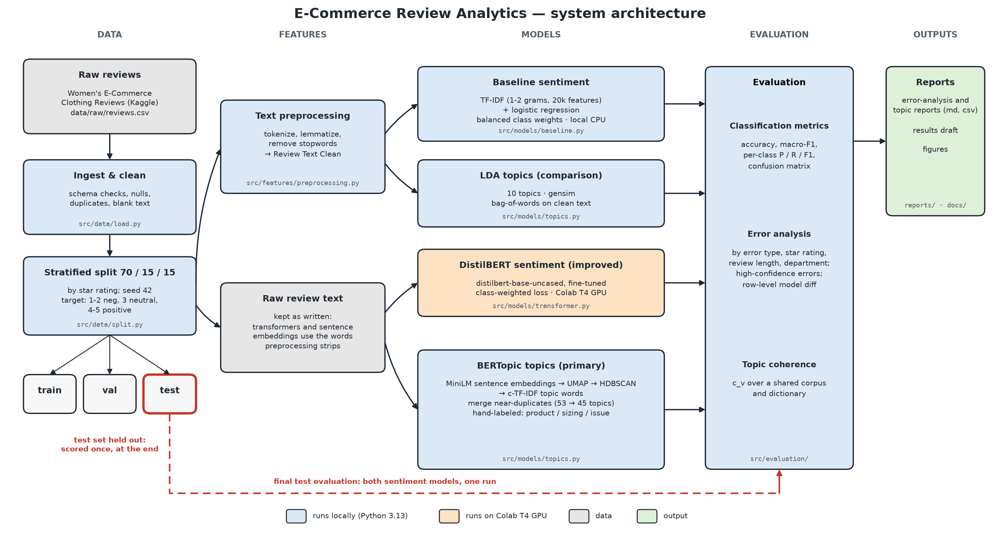

# Milestone 2: Technical Checkpoint

**CS5998 Capstone Project · MSc Data Science & Artificial Intelligence**
**Student:** Imasha Sithumini
**Title:** *Customer Review Analytics for E-Commerce: Sentiment Classification and Unsupervised Issue Discovery from Review Text*
**Code:** <https://github.com/Mashi98/Ecommerce-Review-Analytics> (branch `main`, commit `1da6a45`)

---

## 1. Summary

| Milestone 2 requirement | Status | Where |
|---|---|---|
| Data preprocessing completed | Done | Section 2 |
| Exploratory data analysis | Done | Section 3 |
| Baseline and improved method implemented | Done, and compared on validation and test | Sections 4 and 5 |
| System architecture diagram | Done | Section 6 |
| Code or system link | Done | Header; repository structure in Section 7 |
| Demo video (max 6 minutes) | Not part of this document | n/a |

**Headline result.** A fine-tuned DistilBERT improves three-class sentiment macro-F1 over a TF-IDF + logistic regression baseline from **0.618 to 0.667 on the held-out test set** (paired bootstrap difference +0.049, 95% interval [+0.025, +0.074]). Both models are weakest on the neutral class, and the error analysis traces that to the labels as much as to the models. Alongside this, BERTopic and LDA topic models were fitted and compared on coherence, and 45 BERTopic topics were hand-labelled.

The project follows the plan in Milestone 1: Task A is sentiment classification from review text, Task B is unsupervised issue discovery. No external LLM APIs are used; every model is trained or fine-tuned on this dataset.

---

## 2. Data and preprocessing

**Dataset.** *Women's E-Commerce Clothing Reviews* (Kaggle, public, no personal identifiers): 23,486 reviews, 11 columns. The file is not redistributed; its SHA-256 and download steps are in `docs/reproducibility.md`.

**Cleaning and splitting** (`src/data/`, `src/features/`):

| Step | Rows |
|---|---|
| Raw | 23,486 |
| After dropping 21 exact duplicates and 14 rows missing Division, Department and Class Name | 23,451 |
| Stratified 70/15/15 split by rating, seed 42: train / validation / test | 16,415 / 3,518 / 3,518 |
| After dropping rows with no review text (text tasks only) | 15,824 / 3,417 / 3,386 |

**Target.** Sentiment from the star rating: 1-2 negative, 3 neutral, 4-5 positive.

**Text preprocessing.** Lowercasing, removal of URLs, HTML, digits and punctuation, NLTK tokenization, POS-aware WordNet lemmatization and stopword removal. The TF-IDF baseline and LDA use the cleaned text. DistilBERT and the BERTopic embeddings use the raw text, because subword tokenizers and sentence encoders use exactly the words and punctuation that lemmatization strips.

**Reproducibility of the splits.** Regenerating them gives byte-identical files (hashes in `docs/reproducibility.md`). The test set was left untouched until all model decisions were final (Section 5).

---

## 3. Exploratory data analysis

Full analysis: `notebooks/01_eda.ipynb`. The findings that shaped the modelling:

| Finding | Consequence |
|---|---|
| 77.5% of reviews are positive, 12.2% neutral, 10.2% negative | A model that always says "positive" scores 77.5% accuracy. **Macro-F1 is the headline metric** and both models use class weights. In an early baseline sweep the unweighted models had the *highest* accuracy (0.82) and the *lowest* macro-F1 (0.57). |
| 3.6% of rows have no review text; 70% of those are 5-star | Dropped for the text tasks. The effect on the class mix is negligible. |
| Reviews are capped near 500 characters (at most 115 words) | `max_length=256` for DistilBERT truncates essentially nothing. |
| Review length changes only modestly with rating | Length is not a shortcut to the label. |
| 3-star reviews are split on the recommend flag: 41% still recommend the item | The neutral class mixes lukewarm and recommending reviews and has no clean text signature. This predicts that neutral will be the hardest class, and it did turn out to be. |
| Age, Division and Department have bias-corrected Cramér's V below 0.04 with the label | Metadata is not used as a model feature (text-only task); age and department are kept for segmentation. |
| Only 7 extra copies of repeated review text; none shared between train and validation; 1 of 3,386 in test | Duplicate text does not inflate validation or test scores. |

---

## 4. Methods

### 4.1 Task A: sentiment classification

| | Baseline | Improved |
|---|---|---|
| Model | TF-IDF + logistic regression | `distilbert-base-uncased`, fine-tuned |
| Input | Lemmatized, stopword-free text | Raw review text, max 256 tokens |
| Imbalance handling | Balanced class weights | Inverse-frequency class weights in the loss |
| Settings | 20,000 features, 1-2 grams, `min_df` 2, `max_df` 0.9, sublinear TF | lr 2e-5, batch 16, 3 epochs, weight decay 0.01, 500 warmup steps, fp16, seed 42 |
| Model selection | Settings chosen on validation | Best epoch by validation macro-F1 |
| Hardware | Local CPU (seconds) | Colab Tesla T4 (about 20 minutes) |

The baseline was chosen from a comparison of logistic regression and linear SVM, each with no weighting, class weights and SMOTE. Logistic regression with class weights had the best validation macro-F1 (0.6245, against 0.6133 for SMOTE and 0.5869 for the best SVM). Code: `src/models/baseline.py` and `src/models/transformer.py`. The notebook for the GPU run is `notebooks/02_distilbert_colab.ipynb`.

### 4.2 Task B: issue discovery

LDA (10 topics) and BERTopic (`all-MiniLM-L6-v2` embeddings, UMAP, HDBSCAN) were fitted on the training reviews and scored on `c_v` coherence over a shared tokenized corpus.

| Model | Configuration | Topics | c_v | Unassigned reviews |
|---|---|---|---|---|
| LDA | 10 topics | 10 | 0.4701 | n/a |
| BERTopic | min size 50, 10 topics | 9 | 0.4039 | 8.1% |
| **BERTopic (primary)** | **min size 25, automatic count** | **53** | **0.4543** | 32.3% |
| BERTopic, near-duplicates merged | same, merged | 45 | 0.4536 | 32.3% |

LDA has the higher coherence, but its ten topics are broad and blurry ("look, make, fit"). BERTopic at min size 25 surfaces specific, readable topics, including issue topics (itchy wool, sheer white items, missing buttons) that the ten-topic version merges away. It is therefore the primary model; the cost is that 32% of reviews are left unassigned. Near-duplicate topics (three jacket topics, three xs/xxs sizing topics) were merged by c-TF-IDF similarity, taking 53 topics to 45 with coherence unchanged.

All 45 topics were labelled by hand after reading sample reviews. Of the 10,716 clustered reviews, 77% fall in product-category topics, 11% in sizing and fit, and only 2% in the five issue topics (itchy wool, sheerness needing a cami, sheer white items, care instructions, missing buttons). Most of what topic modelling finds here is *what the product is*; complaints are dominated by fit and sizing rather than defects.

---

## 5. Results

### 5.1 Sentiment classification

Both models are scored on the validation split (used for model and setting choices) and on the test split, which was scored **once**, after every decision was final.

| Model | Split | Accuracy | Macro-F1 | Weighted-F1 |
|---|---|---|---|---|
| TF-IDF + LogReg | validation | 0.7951 | 0.6245 | 0.8083 |
| TF-IDF + LogReg | **test** | 0.7930 | **0.6182** | 0.8059 |
| DistilBERT | validation | 0.8288 | 0.6785 | 0.8411 |
| DistilBERT | **test** | 0.8269 | **0.6670** | 0.8379 |

Per class on the test set (precision / recall / F1):

| Class | Baseline | DistilBERT | Support |
|---|---|---|---|
| negative | 0.491 / 0.598 / 0.539 | 0.585 / 0.668 / 0.624 | 356 |
| neutral | 0.364 / 0.467 / 0.409 | 0.397 / 0.512 / 0.447 | 420 |
| positive | 0.943 / 0.872 / 0.906 | 0.963 / 0.899 / 0.930 | 2,610 |

**Is the gain real?** A paired bootstrap over test reviews (2,000 resamples) gives a DistilBERT minus baseline macro-F1 of **+0.0488, 95% interval [+0.0249, +0.0741]**, and DistilBERT won in every resample. The sign is certain; the size is less so, since the interval's lower end is about half the point estimate. Macro-F1 falls only 0.006 (baseline) and 0.012 (DistilBERT) from validation to test, so there is no sign of serious overfitting to validation.

### 5.2 Error analysis

(`reports/error_analysis_*.md`; written up in `docs/results-draft.md`, section 2.)

- **Where DistilBERT helps.** On test, positive reviews wrongly called negative fall from 90 to 34 and negative reviews wrongly called positive from 45 to 20. Errors involving the neutral class barely move.
- **Where both fail.** Error rate by rating on test (DistilBERT): 1 star 20%, 2 stars 40%, **3 stars 49%**, **4 stars 28%**, 5 stars 3%. The middle of the scale is hardest, and 379 of the baseline's 701 test errors are shared with DistilBERT.
- **Why: label noise.** Sentiment is derived from the rating, so some "errors" are label disagreements. Typical cases are 4 or 5-star reviews that praise the item but report a fit problem ("I loved the jumpsuit but unfortunately had to return it due to running a little on the small size"), and 3-star reviews that read as negative ("...the fabric felt super cheap... returned"). This matches the EDA finding about the recommend flag, and it is the main reason not to over-interpret small macro-F1 differences.
- **Length and department.** Errors rise with length (9% at 20 words or fewer, 21% above 100) and vary little by department (15% to 19%).

### 5.3 Reproducibility note

DistilBERT training on a GPU is not bit-reproducible even with a fixed seed: three runs with identical settings gave validation macro-F1 0.676, 0.6823 and 0.6785. The reported figures come from the final run, whose weights, run record and predictions were saved. A re-run should land within about 0.006 of these values. The full checklist is `docs/reproducibility.md`.

---

## 6. System architecture

*Figure 1. Raw reviews are ingested, cleaned and split once. The cleaned text feeds the TF-IDF baseline and LDA; the raw text feeds DistilBERT (trained on a Colab T4 GPU) and BERTopic. Evaluation covers classification metrics, error analysis and topic coherence, and feeds the reports. The test split is held out and scored once, at the end. Generated by `scripts/architecture_diagram.py`.*

---

## 7. Code and repository

Repository: <https://github.com/Mashi98/Ecommerce-Review-Analytics>. Incremental commits from the first week; the 139-test `pytest` suite covers the data, features, models and evaluation code, and passes on the submitted commit.

| Path | Contents |
|---|---|
| `src/data/`, `src/features/` | Loading, cleaning, splitting, text preprocessing |
| `src/models/` | Baseline, DistilBERT fine-tuning, topic models |
| `src/evaluation/` | Metrics, bootstrap, error analysis |
| `scripts/` | Reproduction commands: splits, topic sweep and merge, test evaluation, error analysis |
| `notebooks/` | EDA and the Colab DistilBERT notebook |
| `reports/` | Results, error analyses, topic labels, figures |
| `docs/` | Milestone documents, results draft, reproducibility checklist |
| `tests/` | Unit tests |

Setup and run instructions are in the `README.md` and `docs/reproducibility.md` (Python 3.13, exact versions in `requirements-lock.txt`). The dataset is not included and must be downloaded from Kaggle.

---

## 8. Limitations and next steps

- **Label noise.** Sentiment is a proxy from star ratings; the neutral class and the 3-to-4-star boundary are partly mislabelled by construction, which caps what any model can achieve on this target.
- **Single split.** There is no cross-validation, and DistilBERT varies by about 0.006 macro-F1 between runs. The bootstrap interval covers test-sample noise only.
- **Topic coverage.** 32% of reviews are BERTopic outliers and are excluded from topic statistics. The department breakdown is weak because most dress reviews fall into one large topic. Topic labels are one reader's judgement.
- **Scope.** One retailer's women's clothing reviews; results may not carry over to other categories.

**Toward the final submission:** link topics to sentiment per review so each segment can be explained by the issues driving it (a first version of this join is already in the repository, `reports/topic_assignments.csv`), write up the full report with business interpretation, and complete the reproducibility appendix.
